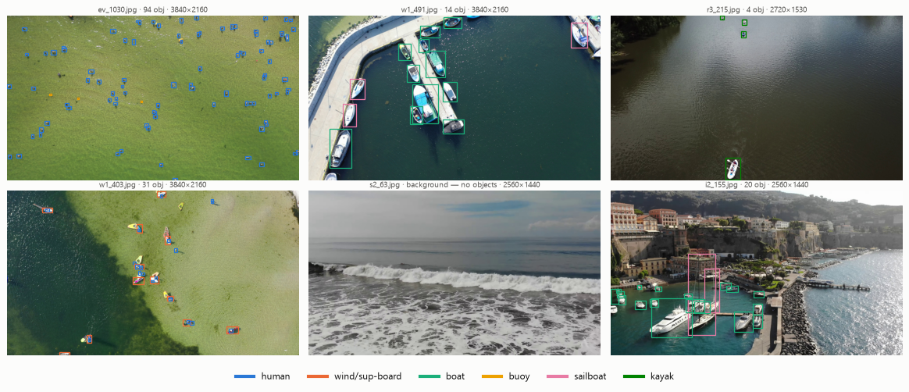
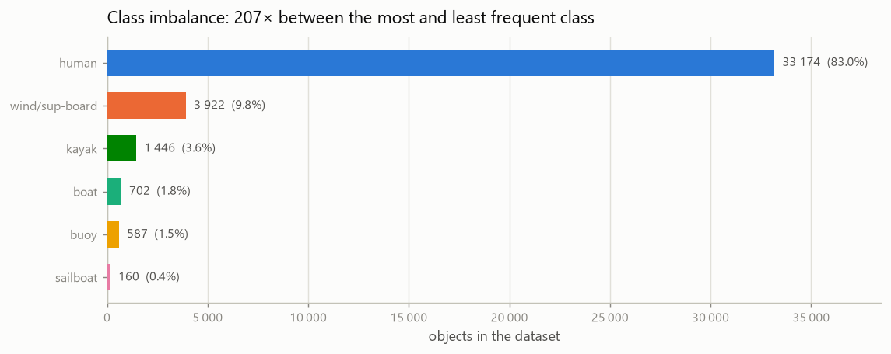
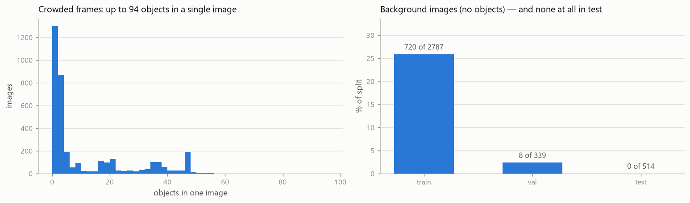
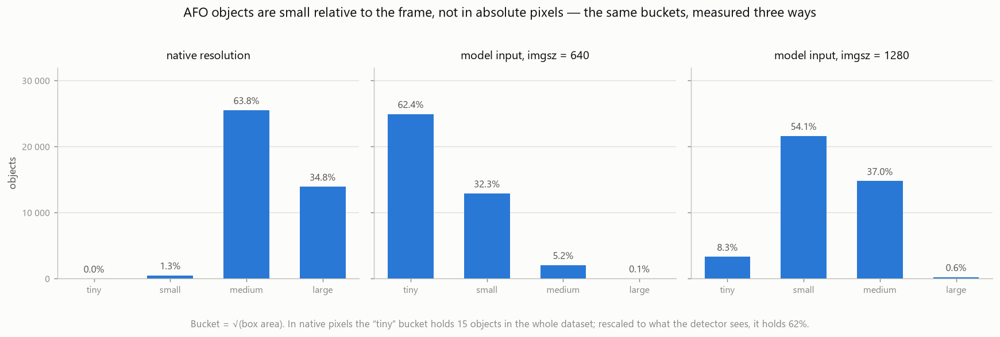
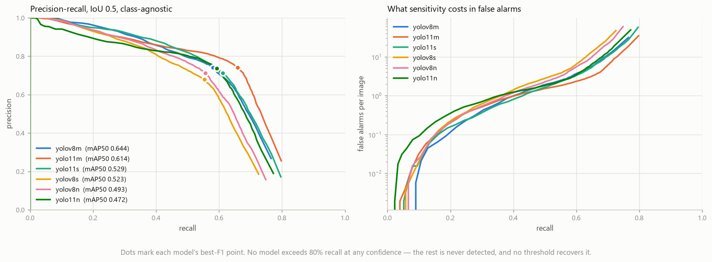

# AFO — Aerial dataset of Floating Objects

**AFO** is a maritime search-and-rescue object detection dataset: **3,641 drone images** with **39,991 hand-annotated objects** in **6 classes** (human, wind/sup-board, boat, buoy, sailboat, kayak), captured over water from a UAV. Most objects are very small — the median object covers under a thousandth of the frame — which is the point of the dataset: it measures detectors where maritime SAR actually operates. It was released with Gąsienica-Józkowy, Knapik & Cyganek, *"An ensemble deep learning method with optimized weights for drone-based water rescue and surveillance"*, **Integrated Computer-Aided Engineering 28(3), 221–235, 2021**, [doi:10.3233/ICA-210649](https://doi.org/10.3233/ICA-210649). Canonical copy: [**🤗 `jgasienica/afo-dataset`**](https://huggingface.co/datasets/jgasienica/afo-dataset) · original release: [Kaggle](https://www.kaggle.com/datasets/jangsienicajzkowy/afo-aerial-dataset-of-floating-objects) (5,400+ downloads) · mirrors: [Voxel51/FiftyOne](https://docs.voxel51.com/), [Dataset Ninja](https://datasetninja.com/afo), [Roboflow Universe](https://universe.roboflow.com/).

This repository is the missing toolkit: a loader, a COCO export, a single shared evaluator, and reproducible baselines with a leaderboard. AFO has 140+ citations but surveys note it is used as a benchmark less than SeaDronesSee — because until now there was nothing to run and nothing to compare against.



> **No dataset files live in this repository.** Everything downloads from Hugging Face into `~/.cache/afo` (override with `AFO_ROOT`). The official splits and labels are never modified in place.

---

## Quick start

```bash
pip install -e .
```

```python
from afo import AFODataset

ds = AFODataset("test", download=True)     # downloads to ~/.cache/afo on first call
image, anns = ds[0]                        # PIL.Image + list[(class_id, cx, cy, w, h)]
print(ds, anns[0], ds.class_names[anns[0].class_id])
```

```
AFODataset(split='test', images=514, objects=7639, categories='6categories', clip=True)
Annotation(class_id=0, cx=0.7617, cy=0.9069, w=0.0559, h=0.0792) human
```

Export the official splits to COCO JSON (written to the cache, not the repo):

```bash
python scripts/export_coco.py --download          # -> ~/.cache/afo/coco/{train,val,test}.json
```

Reproduce the tables and figures below:

```bash
python scripts/stats.py                 # every number in this README
python scripts/make_figures.py          # every figure, into docs/figures/
```

---

## Classes

<!-- classes:start -->
| id | class | train | val | test | total | share |
|----|-------|-------|-----|------|-------|-------|
| 0 | `human` | 22,272 | 4,391 | 6,511 | **33,174** | 82.95% |
| 1 | `wind/sup-board` | 2,749 | 539 | 634 | **3,922** | 9.81% |
| 2 | `boat` | 506 | 53 | 143 | **702** | 1.76% |
| 3 | `bouy` | 428 | 100 | 59 | **587** | 1.47% |
| 4 | `sailboat` | 115 | 17 | 28 | **160** | 0.40% |
| 5 | `kayak` | 890 | 292 | 264 | **1,446** | 3.62% |
<!-- classes:end -->

Class `3` is spelled **`bouy`** in the released `6categories.names` — a typo in the original release, kept as-is because that file is the source of truth for class indices. `afo.display_name()` maps it to "buoy" for figures.



The dataset is **heavily imbalanced**: `human` is 83% of all objects and `sailboat` 0.4% — a 207× ratio. A model can score well on mAP while being useless on four of the six classes, so the benchmark reports per-class AP.

## Splits

The official splits ship with the dataset as `train.txt`, `validation.txt`, `test.txt` in `PART_1/PART_1/`. The **test set is built from nine videos that appear in neither train nor val**, so it measures generalisation to unseen scenes rather than to unseen frames of seen scenes — a split by sequence, not by frame. Keep these splits: cross-paper comparability is the whole reason they are fixed.

<!-- splits:start -->
| split | images | % images | objects | % objects | objects/image |
|-------|--------|----------|---------|-----------|---------------|
| train | 2,787 | 76.54% | 26,960 | 67.42% | 9.67 |
| val | 339 | 9.31% | 5,392 | 13.48% | 15.91 |
| test | 514 | 14.12% | 7,639 | 19.10% | 14.86 |
| **listed** | **3,640** | 99.97% | **39,991** | 100.00% | 10.99 |
| unlisted (`i3_200.jpg`) | 1 | 0.03% | — | — | — |
<!-- splits:end -->

The split is far more even **by object** (67.4 / 13.5 / 19.1) than **by image** (76.5 / 9.3 / 14.1). The apparent density gap — train 9.7 objects/image against val 15.9 and test 14.9 — is almost entirely **background images**, not busier scenes: counting only images that contain at least one object, the three splits sit at **13.0 / 16.3 / 14.9**. See the next note.

**729 images (20.0%) carry an empty label file — zero annotated objects.** They are deliberate negatives: open water, surf, beach. Their distribution across the splits is extremely uneven:

| split | images with 0 objects | share of split |
|-------|----------------------|----------------|
| train | 720 | **25.8%** |
| val | 8 | 2.4% |
| test | **0** | **0.0%** |

A quarter of the training set is background and the test set contains none. Training therefore sees substantial negative supervision for free.

**This does not mean false alarms go unmeasured.** This is detection, not classification: a detection that matches no ground-truth box lowers precision whether or not the frame contains other objects, and with a median object covering 0.085% of the frame, essentially all of the test set *is* open water. mAP penalises a detector that fires on wave crests exactly as it should.

What the missing background frames do cost is narrower: the operational figure "false alarms per patrol frame on a frame with nothing in it" is not measured directly. It is, however, estimable from the annotated frames, and the benchmark reports it — see the operating-point diagnostic below.

Object counts per image run from 0 to 94; 304 images hold 40 or more.



**Image resolutions:** 2560×1440 (46.5%), 3840×2160 (36.1%), 2720×1530 (14.8%), 1920×1080 (2.6%).

---

## Object size — read this before benchmarking

AFO objects are small **relative to the frame**, not small in absolute pixels. The median object is **81.6 px** across (√area) but covers only **0.085%** of its image, because the images are 2.5K–4K. The distinction decides how you report AP by size.



| bucket | √area | native pixels | at `imgsz=640` | at `imgsz=1280` |
|--------|-------|---------------|----------------|-----------------|
| tiny | < 16² | 15 (0.04%) | 24,951 (62.4%) | 3,320 (8.3%) |
| small | 16²–32² | 509 (1.27%) | 12,917 (32.3%) | 21,631 (54.1%) |
| medium | 32²–96² | 25,533 (63.9%) | 2,075 (5.2%) | 14,795 (37.0%) |
| large | > 96² | 13,934 (34.8%) | 48 (0.12%) | 245 (0.6%) |

Measured in native pixels, 98.7% of objects fall in medium+large and the `tiny` bucket holds **15 objects in the entire dataset** — all of them in test. An AP-tiny column computed that way is noise, not a measurement.

The benchmark therefore buckets objects at a **fixed reference scale** — every image rescaled to a 640 px longest side — which is why 62% of objects land in `tiny`. The scale is deliberately *not* the model's own input resolution: if it were, an object would be `tiny` at 640 and `small` at 1280, and the two runs could not be compared — which would defeat the purpose of running both. See [BENCHMARK.md](BENCHMARK.md) §4.

Object size per class (native px, median √area): `bouy` **35.9** · `human` **77.2** · `kayak` **102.0** · `boat` **125.5** · `wind/sup-board` **175.4** · `sailboat` **238.8**. The two smallest classes are also the two that the benchmark finds hardest — and `human` alone is 83% of all objects, so the dataset's difficulty and its imbalance point the same way. Full breakdown in [notebooks/01_explore.ipynb](notebooks/01_explore.ipynb).

---

## Data notes

These are verified properties of the dataset **as released**. They are documented here, not silently patched — the benchmark evaluates AFO as everyone else receives it.

- **3,641 images, not 3,647.** The paper reports 3,647; six images were never released. Every published count in this repository is computed from the files, not copied from the paper.
- **29 label lines have a coordinate outside `[0, 1]`.** Slightly-off hand annotations at frame edges. **Recommendation: clip on load.** `AFODataset(..., clip=True)` is the default and does exactly that, reporting the count; `clip=False` returns the raw values. The files on disk are never rewritten.
- **Class 3 is spelled `bouy` in `6categories.names`.** A typo in the original release. The loader reads the file verbatim so class indices stay correct; only display is corrected.
- **11 pairs of byte-identical images; 7 of those pairs straddle a split boundary.** All 11 are consecutive `_0`/`_1` frames — the first two frames of a sequence, duplicated at capture:

  | pair | splits | |
  |------|--------|---|
  | `e_0.jpg` / `e_1.jpg` | val / train | leak |
  | `i1_0.jpg` / `i1_1.jpg` | val / train | leak |
  | `k1_0.jpg` / `k1_1.jpg` | val / train | leak |
  | `r2_0.jpg` / `r2_1.jpg` | val / train | leak |
  | `r4_0.jpg` / `r4_1.jpg` | val / test | leak |
  | `w1_0.jpg` / `w1_1.jpg` | val / train | leak |
  | `z2_0.jpg` / `z2_1.jpg` | val / train | leak |
  | `k5_0.jpg` / `k5_1.jpg` | test / test | within split |
  | `s1_0.jpg` / `s1_1.jpg`, `s2_*`, `s5_*` | train / train | within split |

  Six of the seven leaks are val↔train, which inflates val slightly but does not touch the reported numbers; **one, `r4_0`/`r4_1`, is val↔test**, so a single test image has a byte-identical twin in val. That is 1 image of 514 (0.19% of test) and it is the only leak that can affect a reported score. **Recommendation: keep the official splits** and treat this as a documented constant — a private "clean" split makes your numbers incomparable to everyone else's. A de-duplicated variant is future work in [BENCHMARK.md](BENCHMARK.md).
- **`i3_200.jpg` appears in no split list.** It is present in the images and has labels, but belongs to none of train/val/test. `AFODataset("all")` includes it; the three split loaders do not. It is excluded from training and from evaluation.
- **The classes are heavily imbalanced** (see the table above) and **objects are mostly tiny**, so mAP averaged over classes and over sizes hides most of what matters. The benchmark therefore reports per-class AP and AP in AFO-specific size buckets, not just mAP50-95.

All of the above are asserted in [tests/test_counts.py](tests/test_counts.py), so a change to the upstream dataset breaks the tests rather than passing unnoticed.

---

## Benchmark

Reproducible baselines trained on the official train split, selected on val, reported on **test only**, no test-time augmentation, one shared pycocotools evaluator. Full protocol: [**BENCHMARK.md**](BENCHMARK.md). How to add your result: [CONTRIBUTING.md](CONTRIBUTING.md).

AFO ships two label sets, and they are **two different tasks**. This repository keeps a separate leaderboard for each, because a score on one says nothing about the other.

### 1. Six classes — the harder task

`human`, `wind/sup-board`, `boat`, `bouy`, `sailboat`, `kayak`. No baselines for this version have been published before, which is the reason it is here: it is the setting for anyone who needs to know *what* is in the water, and it exposes the 207× class imbalance that the two-class version averages away.

<!-- leaderboard:start -->

**imgsz = 640**

| model | mAP50 | mAP50-95 | AP-tiny (n=4424) | AP-small (n=2930) | params (M) | FPS | weights |
|---|---|---|---|---|---|---|---|
| `yolov8m` | 0.6442 | **0.3324** | 0.2450 | 0.3043 | 25.86 | — | [HF](https://huggingface.co/jgasienica/afo-yolov8m-640) |
| `yolo11m` | 0.6137 | **0.3170** | 0.2917 | 0.2876 | 20.06 | — | [HF](https://huggingface.co/jgasienica/afo-yolo11m-640) |
| `yolo11s` | 0.5290 | **0.2737** | 0.2820 | 0.3030 | 9.43 | — | [HF](https://huggingface.co/jgasienica/afo-yolo11s-640) |
| `yolov8s` | 0.5231 | **0.2630** | 0.2592 | 0.2848 | 11.14 | 70.0 | [HF](https://huggingface.co/jgasienica/afo-yolov8s-640) |
| `yolo11n` | 0.4716 | **0.2417** | 0.2222 | 0.2721 | 2.61 | 63.2 | [HF](https://huggingface.co/jgasienica/afo-yolo11n-640) |
| `yolov8n` | 0.4928 | **0.2401** | 0.2383 | 0.2560 | 3.14 | 66.7 | [HF](https://huggingface.co/jgasienica/afo-yolov8n-640) |

Sorted by test mAP50-95. Size buckets use a **fixed reference scale** — every image rescaled to a 640 px longest side, independent of the training resolution — so AP-tiny means the same population of objects in every row and 640 is directly comparable with 1280. One run per model, no seed-variance estimate: treat gaps under ~1 point as noise. FPS: batch 1, FP16, RTX 4090 **Laptop** GPU, measured in a separate pass after a thermal cool-down with the temperature recorded alongside. mAP does penalise false alarms on water; for the operating-point view (F1-optimal threshold, false alarms per image) read `operating_point` in each `metrics.json` — see [BENCHMARK.md](BENCHMARK.md).
<!-- leaderboard:end -->

#### Operating point — what AP does not show

`mAP` integrates the whole precision-recall curve and averages over classes. A deployed system runs at **one** threshold and cares about objects, not class balance. `metrics.json` records both views under `operating_point` (class-agnostic, IoU 0.5).



| model | mAP50 ↑ | AP50 weighted by object count | best-F1 precision | recall | **recall ceiling** | **objects never found** |
|---|---|---|---|---|---|---|
| `yolov8s` | **0.5231** | 0.5245 | 0.679 | 0.554 | 0.726 | **2,095** |
| `yolov8n` | 0.4928 | 0.5518 | 0.712 | 0.557 | 0.748 | 1,922 |
| `yolo11n` | 0.4716 | **0.5731** | **0.737** | **0.592** | **0.773** | **1,736** |

**The two columns rank the models in opposite orders, and both are correct.** mAP averages the six classes with equal weight, so `yolov8s`'s large wins on the rare classes — `boat` 0.594 against 0.377, `kayak` 0.967 against 0.820, `bouy` 0.113 against 0.051 — outweigh its loss on `human`, which is 85% of all test objects (0.473 against 0.538). Weight by object instead of by class and the order reverses exactly.

The PR curves cross at **recall ≈ 0.37**. Below that the v8 models are marginally ahead; across the entire useful region above it, `yolo11n` dominates on precision and reaches the highest recall.

**The ceiling is the number that should worry a SAR reader.** No model exceeds **77% recall at any confidence** — 1,736 to 2,095 of the 7,639 test objects are never detected, and no threshold tuning recovers them. Neither 80% nor 90% recall is reachable by any of the three, so the "false alarms at 80% sensitivity" question has no answer yet on this dataset.

So: `yolov8s` is better at *telling apart* the rare things it finds, and worse at *finding things at all*. Which model is "best" depends on the question, which is why both columns are published.

Caveats: thresholds are picked on the test split, so these are optimistic upper bounds (deployment would pick on val); matching ignores class, because in SAR finding the object beats naming it; and these are **single-seed runs** — the gaps between the two `n` models are small enough that the ordering between them should not be treated as settled.

### 2. Two classes — continuing the published line

`small_obj` (human + buoy) against `large_obj` (board + boat + sailboat + kayak). This is the version the 2021 paper benchmarked, so a result here extends a line that already exists in the literature instead of starting a private one. It is also closer to how maritime SAR actually works: finding the object matters more than naming it.

```bash
python scripts/train_ultralytics.py --model yolo11n --imgsz 640 --categories 2categories
```

<!-- leaderboard2cat:start -->
| model | source | imgsz | AP | AP@50 | AP@50 `small_obj` | AP@50 `large_obj` | weights |
|---|---|---|---|---|---|---|---|
| SSD300 (MobileNet v2) | paper 2021 | 300 | 14.35 | 41.40 | 24.34 | 58.45 | — |
| YOLOv3 (Darknet53) | paper 2021 | 544 | 24.40 | 68.58 | 51.08 | 86.08 | — |
| `yolov8n` @640 | **this repo** | 640 | **29.71** | **67.45** | 44.23 | 90.67 | [HF](https://huggingface.co/jgasienica/afo-yolov8n-640-2cat) |
| `yolov8s` @640 | **this repo** | 640 | **31.43** | **70.14** | 46.24 | 94.05 | [HF](https://huggingface.co/jgasienica/afo-yolov8s-640-2cat) |
| YOLOv4 (CSPDarknet53-PANet-SPP) | paper 2021 | 544 | 31.50 | 71.13 | 54.58 | 87.67 | — |
| `yolo11n` @640 | **this repo** | 640 | **32.06** | **72.87** | 56.90 | 88.84 | [HF](https://huggingface.co/jgasienica/afo-yolo11n-640-2cat) |
| `yolo11s` @640 | **this repo** | 640 | **32.08** | **70.67** | 48.04 | 93.30 | [HF](https://huggingface.co/jgasienica/afo-yolo11s-640-2cat) |
| `yolov8m` @640 | **this repo** | 640 | **33.09** | **71.69** | 49.53 | 93.85 | [HF](https://huggingface.co/jgasienica/afo-yolov8m-640-2cat) |
| Faster R-CNN (R50-FPN) | paper 2021 | 1333 | 33.35 | 78.51 | 67.08 | 89.94 | — |
| RetinaNet (R50) | paper 2021 | 1333 | 34.93 | 79.82 | 69.31 | 90.31 | — |
| RetinaNet (R101) | paper 2021 | 1333 | 35.83 | 79.36 | 65.00 | 93.71 | — |
| Faster R-CNN (R101-FPN) | paper 2021 | 1333 | 36.25 | 78.97 | 64.11 | 93.82 | — |
| Ensemble 3 (best AP@50) | paper 2021 | 1333 | 37.20 | 82.16 | 70.31 | 94.00 | — |
| Ensemble 4 (paper's contribution) | paper 2021 | 1333 | 37.71 | 81.55 | 68.39 | 94.71 | — |

AP in percent, as in the paper. `small_obj` = human + buoy, `large_obj` = board + boat + sailboat + kayak — a **semantic** merge, not a box-area threshold, so these columns are per-class AP and not COCO's AP-small/AP-large. Paper rows are reproduced from Table 2 of [doi:10.3233/ICA-210649](https://doi.org/10.3233/ICA-210649) for context; they were produced with different resolutions (300²–1333×750) and a fixed 20k-iteration schedule, so read them as historical reference rather than as rows of the same experiment.
<!-- leaderboard2cat:end -->

---

## How this compares to the original paper

The 2021 paper reports its own baselines. **They are not directly comparable to the table above**, and the reason is easy to miss, so it is spelled out here.

### What reproduces exactly

Every per-class count in the paper's Table 1 matches the released files to the object, computed independently by `scripts/stats.py`:

| | human | board | boat | buoy | sailboat | kayak |
|---|---|---|---|---|---|---|
| train | 22,272 | 2,749 | 506 | 428 | 115 | 890 |
| val | 4,391 | 539 | 53 | 100 | 17 | 292 |
| test | 6,511 | 634 | 143 | 59 | 28 | 264 |

So do the split shares (67.4 / 13.48 / 19.1% of objects) and the claim that over 99% of objects cover less than 1% of the image area — measured: **99.39%**.

### What does not reproduce

- **3,647 images in the paper, 3,641 released.** Six were never published. They must be background frames, since the object count (39,991) matches exactly.
- **"More than 30% of the images contain more than 20 instances."** Measured: **22.2%** of images hold more than 20 objects. The 30% figure fits a threshold of **10** objects (30.8%), which looks like a transcription slip. Neither number changes any conclusion in the paper.

### Why the paper's Table 2 is a different measurement

| | paper Table 2 | this leaderboard |
|---|---|---|
| classes | **2** (`small_obj`, `large_obj`) | **6** |
| "Small/Large Object" columns | **per-class AP** for the two merged classes | — (we report per-class AP for all 6) |
| input resolution | 544² (Darknet), 1333×750 (Detectron2), 300² (SSD) | 640, and 1280 for the best models |
| schedule | fixed 20k iterations (50k for SSD) | 100 epochs, early stopping patience 20 |
| evaluator | COCO AP | COCO AP via pycocotools, maxDets 300 |

The two-category version merges **human + buoy → `small_obj`** and **board + boat + sailboat + kayak → `large_obj`** (paper §3.1). That is a *semantic* merge, despite the names — it is **not** a threshold on box area. Reading `AP@50 Small Object` in Table 2 as "AP for small objects" in the COCO size sense is the natural misreading, and it is wrong.

### Reading the two-class leaderboard against Table 2

The [two-class leaderboard](#2-two-classes--continuing-the-published-line) above interleaves this repository's runs with the paper's Table 2, so the comparison is in one place. Two things are worth pulling out of it.

**Where YOLO11n lands.** A 2.6 M-parameter model from 2024, trained for 39 minutes, edges past YOLOv4 (32.06 against 31.50 AP; 72.87 against 71.13 AP@50). It is still **1.3–4.2 AP behind the two-stage Detectron2 baselines** and **5.7 AP behind the paper's ensemble**.

**Where the gap is.** Entirely on small objects. On `large_obj` YOLO11n is within 1.5 points of the best single model in the paper (88.84 against 93.82 AP@50). On `small_obj` it is **12.4 points behind** RetinaNet-R50 (56.90 against 69.31). Five years of architecture progress at nano scale buys rough parity on vessels and closes none of the small-object gap — which is the claim the paper made in 2021, now measured with a different toolchain.

**Why a post-hoc merge is not used for these rows.** A 6-class model's predictions *can* be collapsed into the two-class scheme, and `afo/evaluate.py` does record that under `two_category` in every 6-class `metrics.json`. But it is a different experiment: measured on YOLO11n @640, training directly on two classes beats the merged 6-class model by **+0.49 AP and +2.75 AP@50**, with the largest gain on `small_obj` (+3.45). The merge is a usable lower bound and a free diagnostic — it is not a leaderboard row, and the two-class table contains only models actually trained on two classes.

Remaining caveats: resolutions differ (544² and 1333×750 in the paper, 640 here), schedules differ (fixed 20k iterations against 100 epochs with early stopping), and these are single-seed runs.

---

## Citation

```bibtex
@article{gasienica2021afo,
  title    = {An ensemble deep learning method with optimized weights
              for drone-based water rescue and surveillance},
  author   = {G{\k{a}}sienica-J{\'o}zkowy, Jan and Knapik, Mateusz and Cyganek, Bogus{\l}aw},
  journal  = {Integrated Computer-Aided Engineering},
  volume   = {28},
  number   = {3},
  pages    = {221--235},
  year     = {2021},
  publisher= {IOS Press},
  doi      = {10.3233/ICA-210649}
}
```

---

## License

- **Data** — [CC BY-NC-SA 3.0](https://creativecommons.org/licenses/by-nc-sa/3.0/). Non-commercial, share-alike, attribution required. **Models trained on AFO inherit this restriction**; the checkpoints published with this benchmark are for research use only.
- **Code** in this repository — MIT.

See [LICENSE](LICENSE) for both texts. The sample frames in `docs/figures/` are drawn from the dataset and carry the data licence; they are regenerated by `scripts/make_figures.py` rather than curated by hand.

## Acknowledgements

Collected under Polish National Science Center grant **2016/21/B/ST6/01461**.

Footage by **Agnieszka Malonik Taggart**, **Wojciech Sulewski**, **Dariusz Nawrocki** and **Wojciech Kubiela**, whose drone material made the dataset possible.

The original experiments in the paper used [AlexeyAB/darknet](https://github.com/AlexeyAB/darknet).

This toolkit and benchmark were built with [Claude Code](https://claude.com/claude-code).

## Author

**Jan Gąsienica-Józkowy** — [Google Scholar](https://scholar.google.com/citations?user=) · ORCID [0009-0009-7120-9083](https://orcid.org/0009-0009-7120-9083) · Hugging Face [`jgasienica`](https://huggingface.co/jgasienica)
