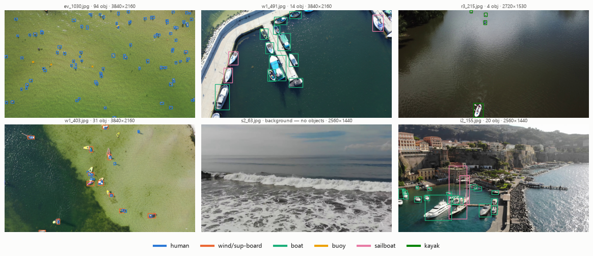
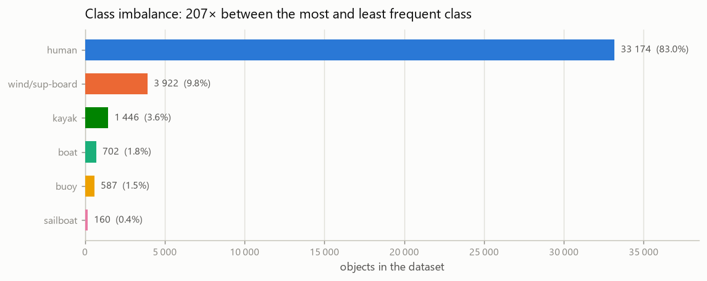
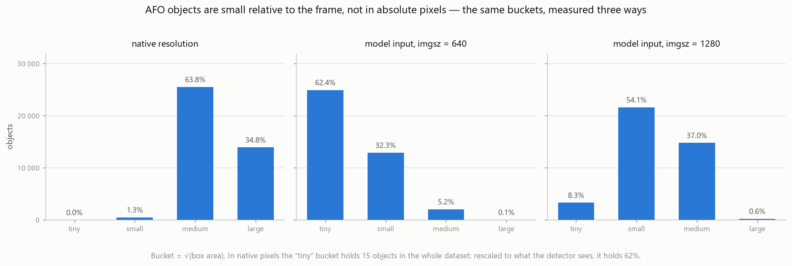
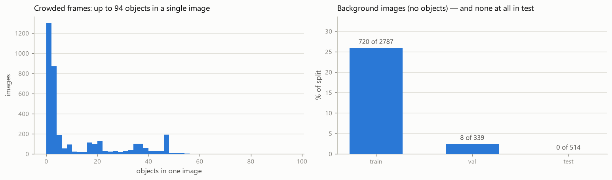

<!--
Proposed card for https://huggingface.co/datasets/jgasienica/afo-dataset — NOT yet pushed.
Adds the figures and a baselines section to the card currently live there.
Pushing it also requires the referenced images:
  huggingface-cli upload jgasienica/afo-dataset docs/figures figures --repo-type=dataset
  huggingface-cli upload jgasienica/afo-dataset docs/dataset-card.md README.md --repo-type=dataset
-->

# AFO – Aerial dataset of Floating Objects

AFO is a set of drone-captured images of people and objects floating on water, built for maritime
search-and-rescue perception. It was among the first freely available datasets for this task, and it
remains one of the few that targets very small objects seen from altitude over open water.



Reproducible detection baselines on the official splits — loader, COCO export and a shared evaluator —
are at **[github.com/Panicum/afo-benchmark](https://github.com/Panicum/afo-benchmark)**.

## Contents

3,641 images extracted from 50 drone videos, carrying **39,991 annotated objects**. Most objects are
small: they are swimmers and boards seen from tens of metres up, often only a few dozen pixels across.
729 images contain no annotated object and are kept as negatives.

Measured image resolutions (four distinct sizes):

| resolution | images |
|---|---|
| 2560 × 1440 | 1,694 |
| 3840 × 2160 | 1,315 |
| 2720 × 1530 | 539 |
| 1920 × 1080 | 93 |

The six classes, **in index order** (original spelling from `6categories.names` preserved):

| index | class | objects |
|---|---|---|
| 0 | `human` | 33,174 |
| 1 | `wind/sup-board` | 3,922 |
| 2 | `boat` | 702 |
| 3 | `bouy` | 587 |
| 4 | `sailboat` | 160 |
| 5 | `kayak` | 1,446 |



`human` is 83 % of all objects and `sailboat` 0.4 %, so per-class results matter more here than a
class-averaged mAP.





Images are also dense: a single frame carries up to 94 annotated objects, which is why the benchmark
raises pycocotools' `maxDets` above the COCO default of 100.

Splits, as shipped in the original release:

| split | list file | images | objects | share of objects |
|---|---|---|---|---|
| train | `train.txt` | 2,787 | 26,960 | 67.42 % |
| val | `validation.txt` | 339 | 5,392 | 13.48 % |
| test | `test.txt` | 514 | 7,639 | 19.10 % |

The test split is drawn mostly from source clips that do not appear in train or val: of the 17 filename
prefixes in `test.txt`, 14 occur nowhere else, and the other three (`a`, `z3`, `r4`) contribute
frame ranges that are almost entirely disjoint from their train/val frames.

## Format

Darknet YOLO. **This repository reproduces the original Kaggle release byte-for-byte, including its
three-part layout and the doubled directory nesting** — nothing was merged, renamed or re-indexed.

```
PART_1/PART_1/
  images/              1,014 .jpg
  6categories/         3,641 .txt   ← the 6-class labels (use these)
  2categories/         3,641 .txt   ← same boxes, collapsed to small_obj / large_obj
  1category/           3,641 .txt   ← same boxes, all classes collapsed to 0
  6categories.names    6 class names, index order
  2categories.names    2 class names
  train.txt  validation.txt  test.txt
  readme.txt
PART_2/PART_2/images/  1,222 .jpg   + readme.txt
PART_3/PART_3/images/  1,405 .jpg   + readme.txt
```

Two things follow from this layout:

- **All labels live in `PART_1`**, for every image in the dataset. `PART_2` and `PART_3` contain images
  only. Each part holds roughly a third of the images, and the three image sets are disjoint.
- Each label file is `<image stem>.txt`, one object per line: `class cx cy w h`, normalised to
  \[0, 1\] relative to image width and height, with `cx cy` the box centre.

The split lists contain bare filenames (`a_102.jpg`), not paths — the image may be in any of the three
parts.

## Loading

```python
import os

ROOT = "."                                    # repository root
P1 = os.path.join(ROOT, "PART_1", "PART_1")
IMG_DIRS = [os.path.join(ROOT, f"PART_{i}", f"PART_{i}", "images") for i in (1, 2, 3)]
CLASSES = open(os.path.join(P1, "6categories.names")).read().splitlines()

def find_image(name):                         # images are spread across the three parts
    return next(p for p in (os.path.join(d, name) for d in IMG_DIRS) if os.path.exists(p))

for name in open(os.path.join(P1, "train.txt")).read().split():
    label_path = os.path.join(P1, "6categories", os.path.splitext(name)[0] + ".txt")
    boxes = [(int(c), float(x), float(y), float(w), float(h))
             for c, x, y, w, h in (ln.split() for ln in open(label_path) if ln.strip())]
    print(find_image(name), len(boxes), "objects")
```

A packaged loader, COCO export, dataset statistics and trained baselines are in
[afo-benchmark](https://github.com/Panicum/afo-benchmark).

## Baselines

18 runs on the official test split, one shared pycocotools evaluator, weights published per run.
Full tables and protocol: [afo-benchmark](https://github.com/Panicum/afo-benchmark).

**Six classes** (10 runs) — best is `rfdetr-base` at 640: **0.4080** mAP50-95, 0.7279 mAP50.

**Two classes** (8 runs), the merge used in Table 2 of the paper — `small_obj` = human + buoy,
`large_obj` = the rest. Best is `rfdetr-nano` at 640: **36.44** AP, 81.23 AP@50, 67.63 AP@50 on
`small_obj`. For reference, Table 2's strongest single model reached 36.25 AP and its best ensemble
37.71 AP — but those were trained at 300²–1333×750 on a fixed 20k-iteration schedule, so read the
comparison as context, not as rows of one experiment.

Each run is a single seed, so differences under roughly 1 AP point should not be read as real.

## License

Creative Commons Attribution-NonCommercial-ShareAlike 3.0 (CC BY-NC-SA 3.0). You must attribute the
work as specified by the authors, you may not use it for commercial purposes, and derivative works must
carry the same license. For commercial use, contact the authors.

## Citation

```bibtex
@article{gasienica2021afo,
  author  = {G{\k{a}}sienica-J{\'o}zkowy, Jan and Knapik, Mateusz and Cyganek, Bogus{\l}aw},
  title   = {An ensemble deep learning method with optimized weights for drone-based water rescue and surveillance},
  journal = {Integrated Computer-Aided Engineering},
  year    = {2021}, volume = {28}, number = {3}, pages = {221--235},
  doi     = {10.3233/ICA-210649}
}
```

## Mirrors

Original release on Kaggle (5,400+ downloads):
<https://www.kaggle.com/datasets/jangsienicajzkowy/afo-aerial-dataset-of-floating-objects>

AFO is also redistributed via Voxel51/FiftyOne, Dataset Ninja and Roboflow Universe. Counts on those
mirrors may differ from the ones above, because some of them merge, re-split or re-encode the data.
This copy is canonical and byte-identical to the Kaggle release.

## Acknowledgements

Supported by the Polish National Science Center, grant 2016/21/B/ST6/01461.

Thanks to Agnieszka Malonik Taggart, Wojciech Sulewski, Dariusz Nawrocki and Wojciech Kubiela, the
photographers who contributed the source videos.

## Author

Jan Gąsienica-Józkowy ·
[Google Scholar](https://scholar.google.com/citations?user=rgopfo8AAAAJ&hl=en) ·
ORCID [0009-0009-7120-9083](https://orcid.org/0009-0009-7120-9083)
